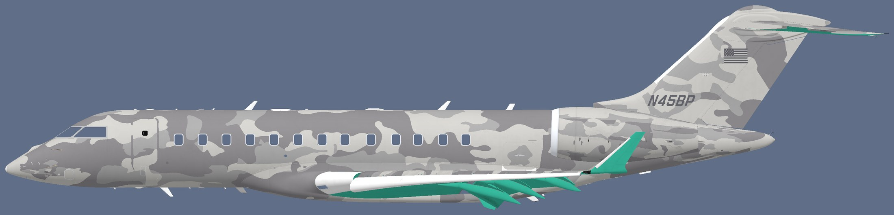
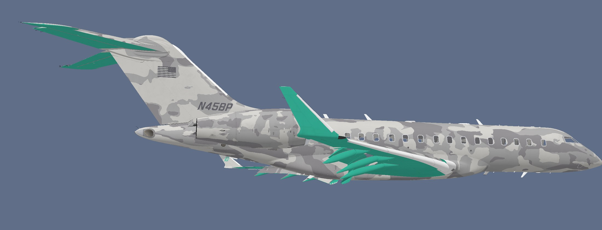
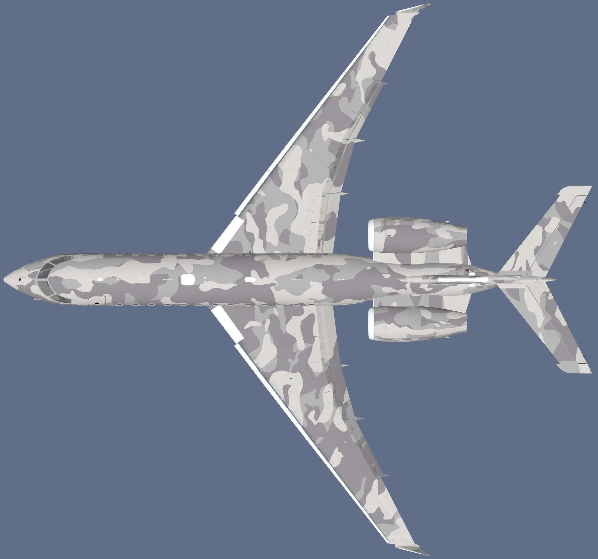

# N45BP — iniBuilds Global Jet (MSFS 2024)

Repaint of the real-world **N45BP** (Bombardier Global 5000, s/n 9207): three-tone grey camouflage,
turquoise-green undersides and winglets, subdued US flag and dark-grey `N45BP` on the fin.
Painted on the official **iniBuilds Global Jet paint kit v1.0** UV layout (7 fuselage/tail UDIM tiles,
2 engine sheets, 4 wing tiles, all 4096 × 4096).





## Status

| Part | State |
|---|---|
| Exterior artwork (13 albedo textures) | **Done** — checked by rendering the paint kit's 3D model from the same camera positions as the real photos |
| Cockpit registration placard | **Done** (`textures/Registration_ALBD.png`, the file name the kit asks for) |
| Thumbnails (720×344, 830×260, 930×340) | **Done** |
| Drop-in Community package | **Built on guessed names** — `community-package/`, see below |
| In-sim test | **Not done** — I have no simulator here |

### The package in `community-package/` is a guess

Copy the folder `community-package/n45bp-livery-inibuilds-global-jet` into your MSFS 2024 **Community** folder.

The paint kit ships PSDs and a model but no template livery, and it does not say what the sim calls
the aircraft folder, the livery `texture` folder or the texture files. A livery only loads if those
match exactly. The package uses these guesses (all in `tools/names.json`):

| What | Guess | Based on |
|---|---|---|
| Aircraft folder | `glex` | iniBuilds' MSFS 2024 A350 lives in `SimObjects\Airplanes\A350`; GSX names profile folders company + aircraft (`microsoft-a330`, `inibuilds_glex`). The first attempt (`inibuilds_glex` etc.) did not show up in the sim |
| Livery location | `liveries/community/N45BP/` with `livery.cfg`, `texture/`, `thumbnail/` | MSFS 2024 SDK documentation |
| Texture names | `GLEX_EXT_ALBD--1001` … `--1007`, `GLEX_ENG_L/R_ALBD` (also as `--1001`), `GLEX_WING_L/R_ALBD--1001/1002` | material names in the kit's 3D model + the `LIVERY_ALBD--…` pattern of iniBuilds' A350 liveries — **least certain** |
| Placard | `Registration_ALBD` | stated in the kit |
| Texture format | BC7 `.PNG.DDS` with mipmaps + `.json` | the usual community livery format; the SDK itself builds `.ktx2` |

How to read the result in the sim:

- **"N45BP (camo)" is not in the livery list** → the aircraft folder or livery layout is wrong.
- **It is in the list but the aircraft looks like the default paint** → the texture names or format are wrong.

Either way, send the file listing of **any one Global Jet livery already in your Community folder**
(the ones iniManager installs are fine): the folder path from `SimObjects` down, the names of the files
in its `texture…` folder(s), and the contents of its `livery.cfg`. Then it is: edit `tools/names.json`,
run `python3 tools/build_package.py`.

What the official MSFS 2024 SDK documentation does fix
([project structure](https://docs.flightsimulator.com/msfs2024/retail/content-configuration/modular-simobjects/modular-simobject-project-structure/),
[livery.cfg](https://docs.flightsimulator.com/msfs2024/retail/content-configuration/cfg-files/livery.cfg/)):

```
SimObjects/Airplanes/<aircraft folder>/liveries/<company>/<livery name>/
    livery.cfg                 [Version] major/minor, [General] name, [Selection] required_tags
    texture[.TAG]/             texture.cfg (fallbacks) + textures, same file names as the base aircraft
    thumbnail/                 thumbnail.png, thumbnail_button.png, thumbnail_side.png
```

Built packages carry textures as `.ktx2`, which the SDK's package builder produces from PNG sources.

## Contents

| Folder | What |
|---|---|
| `textures/` | Final albedo textures: paint + the kit's *Details* layer + the kit's *Weathering* layer (multiply). `EXT_1001…1007` = fuselage/tail UDIMs, `ENG_L/R`, `WING_L/R_1001/1002`, plus `Registration_ALBD.png` |
| `paintkit-sheets/` | Paint only, at the exact canvas size of each kit PSD — paste into the **Paint Here** group of `Master EXT PSD`, `Engine Master`, `Wing Master` |
| `thumbnail/` | The three thumbnails the SDK requires |
| `previews/` | Renders of the kit model wearing the textures (simple shading, not in-sim) |
| `tools/` | The scripts and data that produced the paint (see `tools/README.md`) |

Roughness/metal (COMP) and normal maps are untouched, so polished leading edges, inlet lips and window
frames stay as iniBuilds made them.

## How close is it to the real aircraft?

**Taken from photographs** (projected onto the 3D model through a solved camera for each photo):

- Left fuselage side, roughly window line up to near the crown and down to the lower fuselage — from a 4832 px
  daylight photo; the camera solution fits the doors, windows and tail to within about 5–10 cm.
- Right fuselage side between about the window line and lower fuselage — from two 1280–1920 px dusk photos,
  so shapes are right in broad strokes but less precise.
- Fin, both sides, including the exact outline of the `N45BP` lettering (traced, not a font), its position, and
  the flag position, size and proportions.
- Engine nacelles, outboard faces only.
- The three grey tones, the green, and the registration/flag greys (measured, then corrected for exposure).

**Filled in the same style where no photo shows the surface:** fuselage crown and belly, inboard nacelle faces,
the upper part of the fin, the top of the wings and stabiliser.

**Things to know:**

- N45BP is a Global **5000**; the sim aircraft is a Global **6000**, about 0.8 m longer ahead of the wing with
  extra windows. The real pattern is kept in place fore and aft of that plug; the plug itself is filled in.
- **Wing upper surface: assumed camouflage.** Photos confirm camouflage on top of the stabiliser and green
  underneath it; they confirm green flap-track fairings and winglet outer faces. No photo I could reach shows the
  top of the wing. A desk model of this aircraft shows plain silver wings — but it also shows a plain stabiliser,
  which the photos contradict. If you know it is plain, it is a one-line change.
- **Winglet inner-face emblem** is an approximation: the only source is about 17 × 24 pixels.
- **SELCAL** on the cockpit placard is left blank; I could not find the real code.
- A [forum report](https://forum.inibuilds.com/topic/42305-livery-shows-jagged-lines-on-rear-wingroot-portion/)
  says two wing-root UV islands on UDIM 1004 show jagged lines in the sim for custom liveries. If it appears
  here, it is that issue.

## Reference material (not included in this repository)

- Photos: [AeroXplorer — Pablo Armando Armenta, Los Cabos, Dec 2025](https://aeroxplorer.com/viewphoto.php?id=51315);
  [Pinkfroot — Tenerife Sur, May 2026](https://my.pinkfroot.com/photo/n45bp-tfs1920);
  [Pictaero — Corentin Altherr, Geneva, Mar 2026](https://www.pictaero.com/en/pictures/picture,397878)
- [Factory Direct Models desk model of N45BP](https://www.factorydirectmodels.com/gallery-details/13849-bombardier-global-5000-(n45bp)-model-airplane/)
- [iniBuilds Global Jet paint kit v1.0](https://forum.inibuilds.com/topic/42174-paintkit-global-jet/) — the *Details* and
  *Weathering* content baked into `textures/` is iniBuilds' work.
